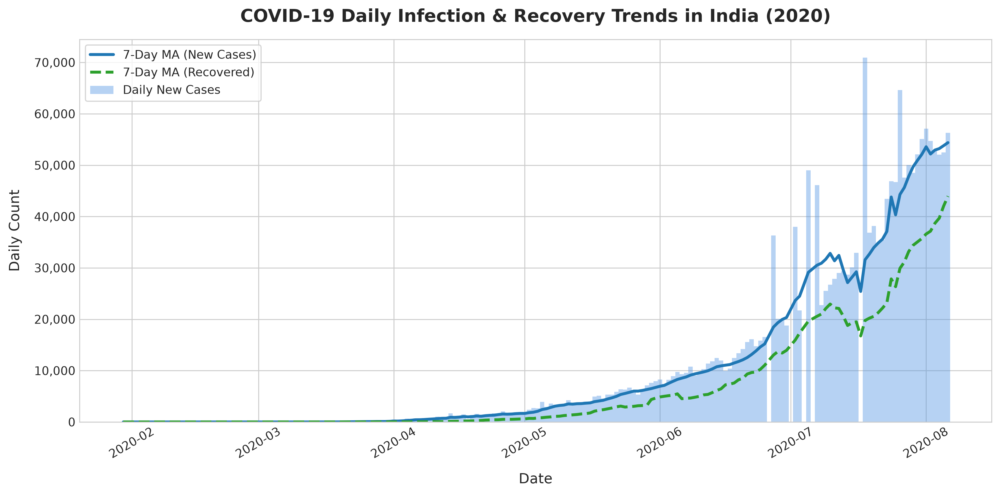
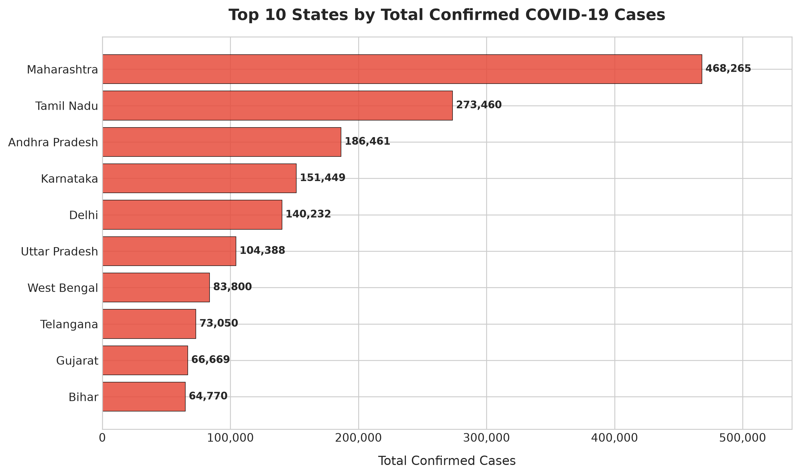
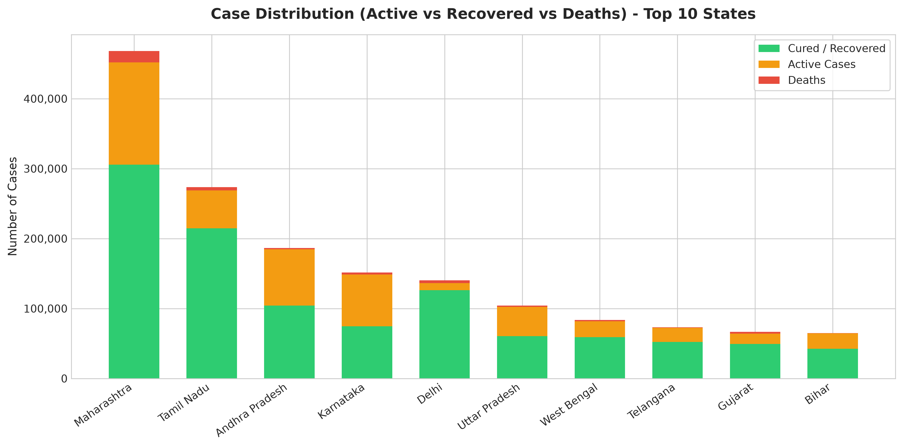
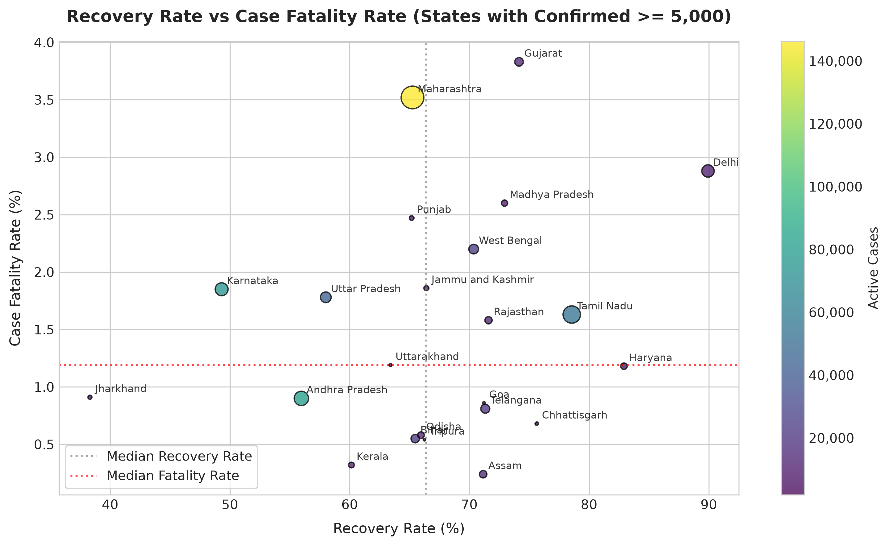
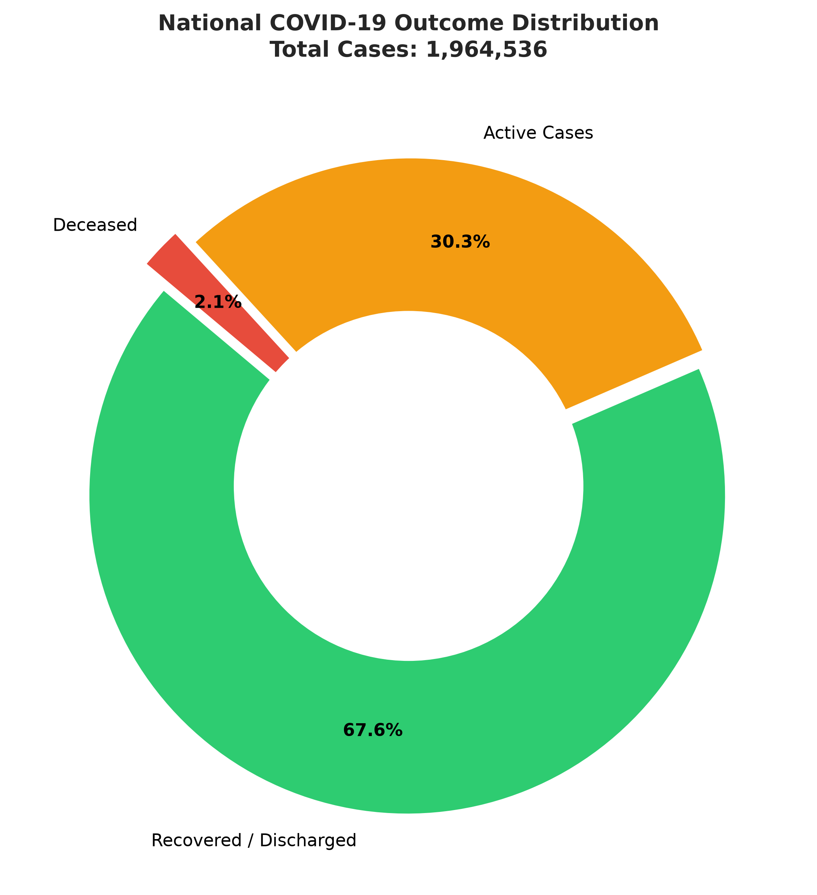
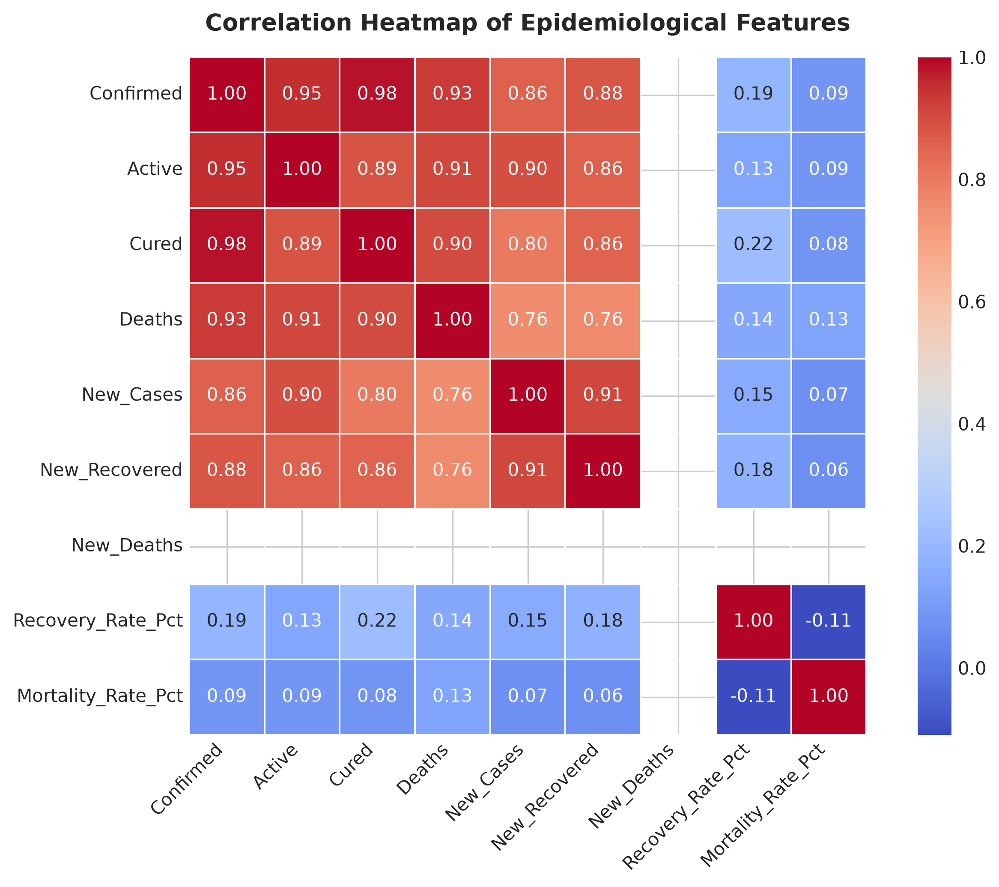

# COVID-19 India: Exploratory Data Analysis & Statistical Modeling

[](https://www.python.org/)
[](https://opensource.org/licenses/MIT)
[](https://pandas.pydata.org/)
[]()

A comprehensive data engineering, preprocessing, and exploratory data analysis (EDA) project evaluating the progression of the **COVID-19 pandemic in India** from **January 30, 2020 to August 06, 2020** across all Indian States and Union Territories.

---

## 📌 Project Overview

This project implements an end-to-end data pipeline:
1. **Raw Ingestion & Sanitization:** Resolves real-world data quality anomalies including inconsistent naming conventions, invalid character artifacts, spatial coordinate errors, and non-monotonic daily deltas.
2. **Feature Engineering:** Computes active caseloads, recovery rates, case fatality rates (CFR), and 7-day rolling moving averages.
3. **Exploratory Data Analysis:** Highlights spatial distribution, macro transmission trends, state-level resilience, and comparative outcome distributions.
4. **Reproducible Packaging:** Modularized Python scripts alongside a dedicated Jupyter Notebook, ready for GitHub submission and academic/industry presentation.

---

## 📊 Key Highlights & Statistical Findings (as of Aug 06, 2020)

| Metric | National Value |
| :--- | :--- |
| **Total Cumulative Confirmed** | **1,964,536** (~1.96 Million) |
| **Active Caseload** | **595,501** (30.31%) |
| **Total Recovered / Discharged** | **1,328,336** (67.62%) |
| **Total Fatalities** | **40,699** (2.07%) |
| **National Recovery Rate** | **67.62%** |
| **National Case Fatality Rate (CFR)** | **2.07%** |

### Top 5 Most Impacted States
1. **Maharashtra:** 468,265 confirmed | 16,476 deaths (CFR: 3.52%)
2. **Tamil Nadu:** 273,460 confirmed | 4,461 deaths (CFR: 1.63%)
3. **Andhra Pradesh:** 186,461 confirmed | 1,681 deaths (CFR: 0.90%)
4. **Karnataka:** 151,449 confirmed | 2,804 deaths (CFR: 1.85%)
5. **Delhi:** 140,232 confirmed | 4,044 deaths (CFR: 2.88%)

---

## 📈 Visualizations & Insights

### 1. National Infection & Recovery Trajectory

*Daily new cases peaked over 55,000–60,000 cases per day in early August 2020. The 7-day rolling average reveals a steep acceleration starting in late June, followed closely by expanding daily recovery counts.*

---

### 2. Top 10 Impacted States by Confirmed Volume

*Maharashtra, Tamil Nadu, Andhra Pradesh, Karnataka, and Delhi collectively accounted for over 60% of all confirmed cases in India.*

---

### 3. Active vs Recovered Distribution in Top States

*Delhi achieved high recovery percentages earlier than southern states like Karnataka and Andhra Pradesh, which were undergoing steeper active surges during July–August 2020.*

---

### 4. Recovery Rate vs. Case Fatality Rate (CFR)

*States with $\ge 5,000$ confirmed cases display significant variance: Delhi and Tamil Nadu demonstrated high recovery rates ($>75\%$), while Gujarat and Maharashtra showed higher CFRs ($>3.5\%$).*

---

### 5. National Outcome Breakdown

*By August 6, 2020, 67.6% of all recorded cases had recovered, 30.3% were actively undergoing treatment, and the overall mortality rate remained controlled at 2.1%.*

---

### 6. Feature Correlation Matrix

*Strong linear relationships ($r > 0.90$) exist between cumulative confirmed cases, cures, and fatalities, validating consistent epidemiological progression across states.*

---

## 🛠️ Data Cleaning & Pipeline Architecture

The cleaning module [`src/data_cleaning.py`](src/data_cleaning.py) performs the following operations:
1. **Name Normalization:** Reconciled spelling variants (e.g., `Telengana`, `Telangana***` $\rightarrow$ `Telangana`; stripping `Union Territory of` prefixes).
2. **Coordinate Imputation:** Fixed missing and zero coordinates `(0.0, 0.0)` for Telangana to accurate geographical centroids `(18.1124, 79.0193)`.
3. **Regex String Sanitization:** Removed invalid typographical artifacts such as `0#` in Puducherry death counts.
4. **Negative Delta Clipping:** Adjusted negative daily values caused by state retrospective data reconciliations.
5. **Derived Metrics:**
   $$\text{Active} = \text{Confirmed} - \text{Cured} - \text{Deaths}$$
   $$\text{Recovery Rate (\%)} = \left(\frac{\text{Cured}}{\text{Confirmed}}\right) \times 100$$
   $$\text{Fatality Rate (\%)} = \left(\frac{\text{Deaths}}{\text{Confirmed}}\right) \times 100$$

---

## 📁 Repository Structure

```text
covid19_india_analysis/
│
├── data/
│   ├── covid19_raw.csv           # Original uncleaned dataset
│   ├── covid19_cleaned.csv       # Standardized time-series dataset
│   └── state_summary.csv         # Latest aggregated state snapshot
│
├── figures/                      # High-resolution output plots
│   ├── daily_trends_india.png
│   ├── top10_confirmed_states.png
│   ├── active_vs_recovered_comparison.png
│   ├── recovery_mortality_rates.png
│   ├── national_case_distribution.png
│   └── correlation_heatmap.png
│
├── notebooks/
│   └── covid19_analysis.ipynb    # Interactive analysis notebook
│
├── src/
│   ├── data_cleaning.py          # Data ingestion and cleaning pipeline
│   ├── eda_analysis.py           # Visualization generation script
│   └── generate_notebook.py      # Notebook automation script
│
├── .gitignore                    # Python and OS file exclusions
├── requirements.txt              # Environment dependencies
└── README.md                     # Comprehensive project documentation
```

---

## 🚀 Quickstart & Reproduction

### 1. Clone the Repository
```bash
git clone https://github.com/<your-username>/<your-repo-name>.git
cd covid19_india_analysis
```

### 2. Set Up Virtual Environment & Dependencies
```bash
python -m venv venv
# On Windows:
venv\Scripts\activate
# On Linux/macOS:
source venv/bin/activate

pip install -r requirements.txt
```

### 3. Run Cleaning & EDA Scripts
```bash
# Clean raw dataset
python src/data_cleaning.py

# Re-generate charts
python src/eda_analysis.py
```

### 4. Run Jupyter Notebook
```bash
jupyter notebook notebooks/covid19_analysis.ipynb
```

---

## 📜 License
This project is open-source under the [MIT License](LICENSE).
