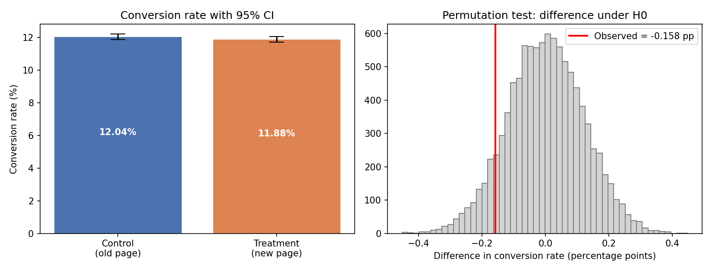

# A/B Test Hypothesis Analysis: Old vs New Landing Page

A statistical hypothesis test to determine whether a redesigned website landing page
increases the user conversion rate compared with the existing page.

## Dataset
`ab_data.csv` : 294,478 rows

| Column | Description |
|---|---|
| `user_id` | Unique visitor ID |
| `timestamp` | Time of the visit |
| `group` | `control` (old page) or `treatment` (new page) |
| `landing_page` | `old_page` or `new_page` |
| `converted` | 1 if the user converted, 0 otherwise |

## Hypotheses
- **H0:** p_new ≤ p_old  (the new page is not better than the old page)
- **H1:** p_new > p_old  (the new page has a higher conversion rate)
- Test: one-sided two-proportion z-test, significance level α = 0.05

## Method
1. **Data cleaning**
   - Removed **3,893** rows where the group and page did not match
     (control saw `new_page` or treatment saw `old_page`).
   - Removed **1** repeated `user_id` (kept first visit).
   - Final dataset: **290,584** users.
2. **Two-proportion z-test** (main test)
3. **Cross-checks:** chi-square test and a 10,000-iteration permutation test
4. **95% confidence interval** for the difference in conversion rate
5. **Power analysis** to confirm the sample size was large enough

## Results

| Group | Users | Conversions | Conversion rate |
|---|---|---|---|
| Control (old page) | 145,274 | 17,489 | 12.04% |
| Treatment (new page) | 145,310 | 17,264 | 11.88% |

| Statistic | Value |
|---|---|
| Difference (new − old) | −0.158 percentage points |
| 95% CI of difference | [−0.394, +0.078] pp |
| z-statistic | −1.31 |
| p-value (one-sided) | 0.905 |
| p-value (two-sided) | 0.190 |
| Chi-square p-value | 0.190 |
| Permutation p-value | 0.907 |



## Conclusion
The p-value (0.905) is far above α = 0.05, so we **fail to reject H0**.
There is no evidence that the new page converts better than the old one. The observed
difference is slightly negative and not statistically significant (the confidence
interval includes 0). With ~145k users per group the test had enough power to detect
even small effects, so the likely conclusion is that the new page makes no meaningful
difference. **Recommendation:** do not roll out the new page on conversion grounds alone;
keep the old page or test a different design.

## Limitations
- Only conversion rate was analysed (no revenue, time on page or segments).
- The data covers roughly 3 weeks, so novelty or day-of-week effects can't be ruled out.
- The reason for the mismatched group/page rows is unknown; they were excluded.

## How to run
```bash
pip install -r requirements.txt
python ab_test_analysis.py
```
Outputs: console summary, `results.json`, `images/ab_test_results.png`.

## Tools
Python, pandas, NumPy, SciPy, statsmodels, matplotlib
